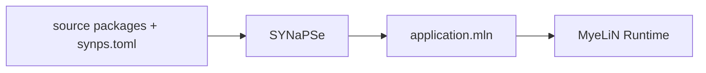

# Repositories

PLeX is split into small repositories with explicit ownership boundaries. The
central documentation site explains how they compose; individual repositories
can keep their README focused on what that repository is.

## Core components

| Repository | Role |
|---|---|
| [SYNaPSe](https://github.com/useplx/SYNaPSe) | Project/package resolution, toolchains, compilation, and artifact build orchestration. |
| [MyeLiN](https://github.com/useplx/MyeLiN) | C++ Graph, Orchestration, and Runtime contracts plus `.mln` execution. |

## Ecosystem packages

Packages add reusable model, codec, retrieval, or application components
without becoming features of the PLeX core itself.

| Repository | Role |
|---|---|
| [Quantizations](https://github.com/useplx/Quantizations) | Weight-storage codecs exported to the Compiler. |
| [RAG](https://github.com/useplx/RAG) | Retrieval/embedding/vector-index building blocks. |
| [Qwen3.5](https://github.com/useplx/Qwen3.5) | Qwen3.5-2B model-port package. |
| [Yolo26](https://github.com/useplx/Yolo26) | Object-detection model package. |

Composition happens through package manifests and the root project's
`synps.toml`; package repositories do not define the core architecture.

## Example projects

| Repository | Role |
|---|---|
| [LaTaupe](https://github.com/useplx/LaTaupe) | Desktop web application firewall combining a compiled XGBoost enforcement graph with asynchronous Qwen3.5 reports. |

Examples are applications built with PLeX, not dependencies or extensions of
the core. See the [LaTaupe walkthrough](../examples/lataupe.md).

## Documentation repository

The MkDocs site is intended to be published at
[useplx.github.io](https://useplx.github.io/). See
[Publishing the docs](publishing-docs.md) for the GitHub Pages workflow.
