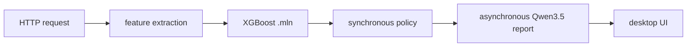

# LaTaupe

[LaTaupe](https://github.com/useplx/LaTaupe) is a complete application example
that keeps enforcement, analysis, and user interface concerns separate.

It demonstrates:

- a C++ graph package described by `synps.toml`;
- an XGBoost classifier compiled into a self-contained `.mln`;
- Python use of the model-agnostic MyeLiN runtime binding;
- a package-owned Qwen3.5 input contract instead of model types in MyeLiN;
- streamed generation kept outside the synchronous enforcement path;
- application policy and desktop orchestration outside the tensor graph.

The generated `.mln` files and model checkpoints are deployment inputs and are
not committed to the source repository. Build the classifier with SYNaPSe,
then install and run the Python application as described in the
[LaTaupe README](https://github.com/useplx/LaTaupe#readme).
