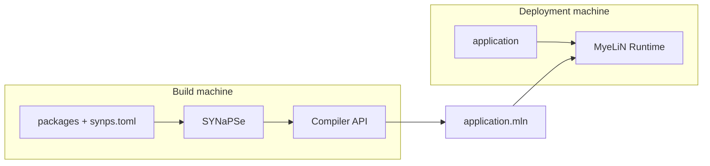
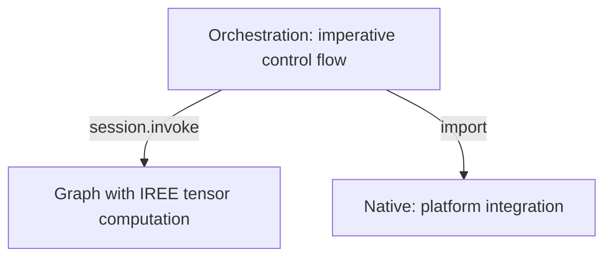

# Architecture

PLeX is deliberately split into build and deployment components.
Model packages do not own deployment policy, and the runtime does not resolve or
compile source packages.

## Components

| Component | Owns | Does not own |
|---|---|---|
| **SYNaPSe** | project and package resolution, configuration validation, toolchain selection, build DAG, Compiler loading, artifact build | application execution |
| **MyeLiN SDK** | Graph, Orchestration, and Native contracts plus common graph building blocks | deployment policy or package resolution |
| **MyeLiN Runtime** | artifact loading, IREE device and session setup, Orchestration and Native modules, graph invocation, state, assets, and output | source compilation |

## Three execution domains

### Graph

Graph build packages are compiled for the **build host** as shared plugins.
SYNaPSe's Compiler loads their package exports, asks the `Mln::Sdk::Module` to
build its tensor graph, lowers the result through MLIR/IREE, and writes the
compiled program into the artifact.

### Orchestration

Orchestration packages contain portable imperative request control. Their
current physical representation is a WebAssembly module. An
`Mln::Sdk::Orchestration` can call graph functions and native imports while
remaining independent from the target CPU instruction set.

### Native

Native build packages are platform libraries for work that requires system or
third-party APIs. They expose the MyeLiN Native ABI and are packaged into the
`.mln` for the deployment architecture.

## Data path

At runtime MyeLiN maps the package, decodes metadata, creates the configured IREE
device/session, attaches parameter providers and graph bytecode, loads native
providers, compiles packaged WebAssembly through Wasmtime, instantiates the
resulting modules, and exposes the artifact's public
entrypoints.

The public host API deals in `Mln::Buffer` bytes. A package defines how those
bytes represent text, tensors, images, structured values, or another protocol.

## Configuration boundary

Package source declares **structure and behavior**. The root project declares **deployment**.
The Compiler applies `policies` by graph path, so the same graph package can be
compiled with different dtypes, storage codecs, or backends without embedding
those choices in `Module` objects.

## Compiler and Runtime target boundary

The bundled SYNaPSe Compiler currently enables the LLVM CPU target backend.
MyeLiN's runtime always enables local CPU drivers and can optionally be built
with CUDA and Vulkan HAL drivers. These are separate build surfaces: a runtime
driver is only useful when the artifact was compiled for a compatible target.

## Artifact boundary

`.mln` is the hand-off between build and deployment. A target machine does not
need the original package sources or the SYNaPSe Compiler to execute an already
built artifact.

See [Artifacts](artifacts.md), [Compilation pipeline](../notes/compilation.md),
and [Execution model](../notes/execution-model.md) for the deeper contracts.
