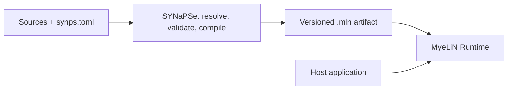

  <h1>PLeX</h1>
  
<strong>Build and run portable, self-contained software artifacts.</strong> Compose compiled graphs, WebAssembly orchestration, native providers, weights, and assets into a versioned <code>.mln</code>.

  

    <a class="plex-action plex-action-primary" href="guide/getting-started/">Start the quickstart</a>
    <a class="plex-action" href="guide/concepts/">Learn the concepts</a>
    <a class="plex-action" href="api/">API reference</a>
  

## Learn PLeX

Follow this path for a first artifact:

1. [Install the tools](guide/install.md).
2. Complete the [Quickstart](guide/getting-started.md) to create, inspect, build, and load an artifact.
3. Read [Core concepts](guide/concepts.md) and [Architecture](guide/architecture.md) to understand the boundaries.
4. Use the [project guide](guide/build-a-project.md) when composing your own packages and deployment policy.

## How it fits together

**SYNaPSe** resolves packages and toolchains, validates the manifest, and
builds the artifact. **MyeLiN** provides the authoring contracts, artifact
format, and runtime APIs. A deployment machine needs the runtime and compatible
drivers, not the SYNaPSe compiler.

The PLeX core and authoring SDK are implemented in C++. Build components can
use additional language toolchains where their execution domain supports them.

## Execution domains

| Domain | Role | Typical output |
|---|---|---|
| Graph | Tensor computation compiled ahead of time through IREE. | IREE bytecode and parameter data |
| Orchestration | Imperative control flow around graph calls. | WebAssembly module |
| Native | Platform integration and providers. | ABI-compatible shared library |
| Driver | Runtime backend integration. | Versioned runtime driver library |

The manifest keeps domain and language separate: for example, a C++ toolchain
can produce graph, orchestration, or native components where that combination
is supported. The [build-domain guide](notes/build-domains.md) explains the
contracts and compatibility rules.

## Choose a task

  <a class="plex-card plex-doc-card" href="guide/create-a-package/"><h3>Author a package</h3>
Publish a graph, codec, hook, or native provider.
</a>
  <a class="plex-card plex-doc-card" href="guide/compose-packages/"><h3>Compose a project</h3>
Resolve dependencies and select build, entrypoint, and deployment policy.
</a>
  <a class="plex-card plex-doc-card" href="guide/quantize-weights/"><h3>Store weights</h3>
Choose codecs and storage schemes independently from graph code.
</a>
  <a class="plex-card plex-doc-card" href="api/bindings/"><h3>Use a language binding</h3>
Inspect artifact metadata, configure the runtime, stream results, and manage buffers.
</a>

## Current support boundary

The repository currently targets Linux. The bundled Compiler enables the IREE
LLVM CPU target by default; CUDA and Vulkan targets and runtime drivers are
optional build features. A deployment requires a compiler target and runtime
driver for the same backend. See [Installation](guide/install.md) before
building and [Devices](notes/devices.md) for backend selection details.

PLeX is not an eager tensor framework and does not provide autograd, optimizers,
or model training. It focuses on composing and deploying compiled workloads.
