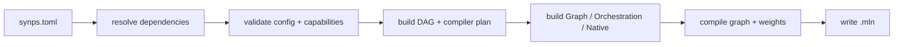

# Build workflow

`synps build` is a planner/executor pipeline. Understanding the order helps
distinguish configuration failures from source-compiler failures and artifact
packaging failures.

## Pipeline



### 1. Load configuration

The root manifest is parsed and typed. Unknown/invalid values fail before any
large build is started.

### 2. Resolve dependencies

Local and Git package sources are traversed, cycles are rejected, and package
capabilities are bound.

### 3. Validate package configuration

Only declared variables may be supplied under `[packages.<alias>]`. Required
capabilities and build-package references must resolve unambiguously.

### 4. Plan build packages

Each `[build.<domain>[.<label>]]` declaration becomes a build node in its
declared domain. The language toolchain selects how that node is produced;
domain compatibility determines its output contract. `extends` and `uses` add
build relationships, and SYNaPSe rejects cycles, missing outputs, and
incompatible runtime composition. Older `[package.<name>]` build declarations
are accepted as compatibility syntax; new manifests should use `[build.*]`.

### 5. Select toolchains

The build chooses explicit package and domain toolchains or language driver
discovery. Graph plugins use a build host toolchain; Native providers may use a
cross toolchain; Orchestration uses a driver capable of producing WebAssembly.

### 6. Build compiler inputs

Graph plugin exports, entrypoints, policies, hooks, source formats, assets, and
weights are normalized into the plan passed through the MyeLiN compiler API.

### 7. Compile and package

The Compiler loads graph exports, constructs/lower graphs, converts weights, and
packages graph output together with orchestration/Native artifacts and assets.
Independent DAG nodes execute concurrently, bounded by `synps build --jobs N`.
Natural graph shards that use the same parameters package share a read-only
backend-resource lease, while builds backed by different parameter packages are
isolated. The default limit is at most 8 jobs.
The parameters node uses the same worker bound for independent weight roots and
forms deterministic batches under `--weight-memory-mib` (2048 MiB by default),
so conversion parallelism cannot blindly multiply decoded-f32 temporaries.

The root output is:

```text
build/<package-name>.mln
```

## Cache

SYNaPSe maintains build outputs and a cache under `build/`. A build reports the
number of executed and cached DAG steps. `synps clean` removes the complete
project build directory.

## Reproducibility boundary

`synps install` writes a `synps.lock` snapshot, but the current resolver does not
load that file during normal resolution. Do not describe the lockfile as a pin
for later builds yet.

For a reproducible Git source today, pin the dependency with `rev = "<commit>"`
and commit the root manifest alongside the project.

## Debug the cheapest layer first

```bash
synps graph
synps inspect
synps build --release
synps build --jobs 8 --release
```

Use `graph` for source/capability resolution, `inspect` for the effective plan,
and only then run the expensive compile.
