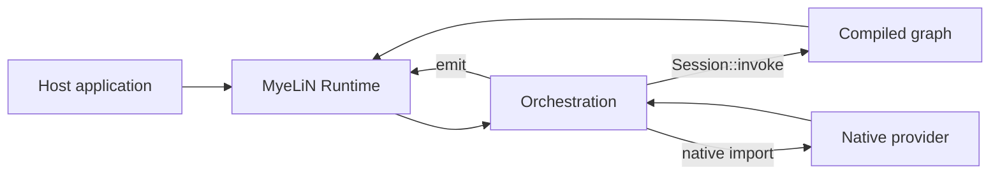

# Execution model

PLeX separates an application into three code domains because tensor
computation, portable control flow, and platform integration have different
compilation and deployment requirements.

## Graph

Graph code is authored with `Mln::Sdk::Module` and tensor operations. A graph
build package is compiled for the **build host** as a plugin so the SYNaPSe
Compiler can load the exported module object and construct MLIR.

The graph itself is then lowered ahead of time through IREE for the selected
compiler target. Model C++ source does not execute on the deployment machine.

Use Graph for deterministic tensor-heavy computation that benefits from AOT
optimization and device execution.

## Orchestration

`Mln::Sdk::Orchestration` contains imperative request control. C and C++
Orchestration is compiled to WebAssembly with WASI and packaged into the artifact.

Typical responsibilities:

- preprocessing sequence and request flow;
- generation or iterative loops;
- session-state updates;
- invoking one or more graph entrypoints;
- calling native imports;
- emitting incremental output.

Orchestration does not derive from `Module`; graph structure and application
control remain different contracts.

## Native providers

Native packages are shared libraries built for the deployment architecture.
They are appropriate when an operation requires OS facilities or third-party
native libraries that should not live in the graph or orchestration layer.

Examples include tokenizer libraries, image codecs, filesystem/system adapters,
or specialized indexes.

## Host boundary

A host application creates `Mln::Runtime`, creates a `Session`, loads the `.mln`,
and invokes a public artifact entrypoint. Input and output cross the public
runtime API as `Mln::Buffer` bytes or supported typed serialization.

The artifact owns the interpretation of those bytes.

## State and output

Named `Session::State` survives across invocations in the same loaded session.
`session.asset()` exposes packaged files. `session.emit()` publishes values to
the host callback during an invocation.

## Artifact as the hand-off

The final `.mln` is the boundary between build and deployment. It can contain:

- IREE graph bytecode;
- encoded parameters;
- Wasm modules;
- Native providers;
- assets;
- entrypoint metadata;
- Runtime hook routes;
- deployment/device metadata.

A deployment host needs the compatible MyeLiN runtime, not the original model
or package source tree.
